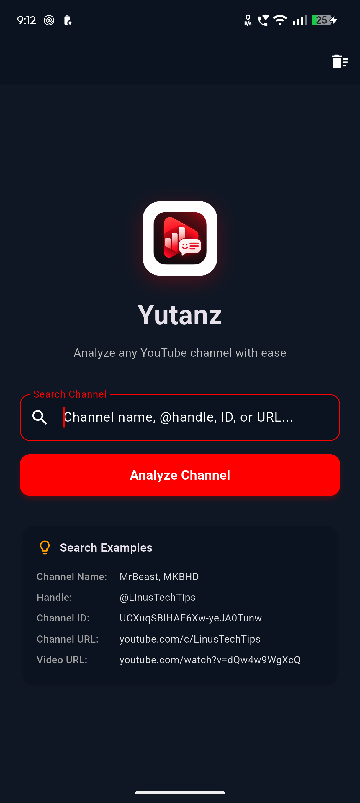
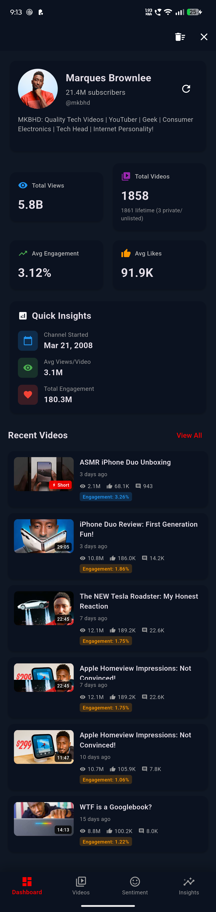
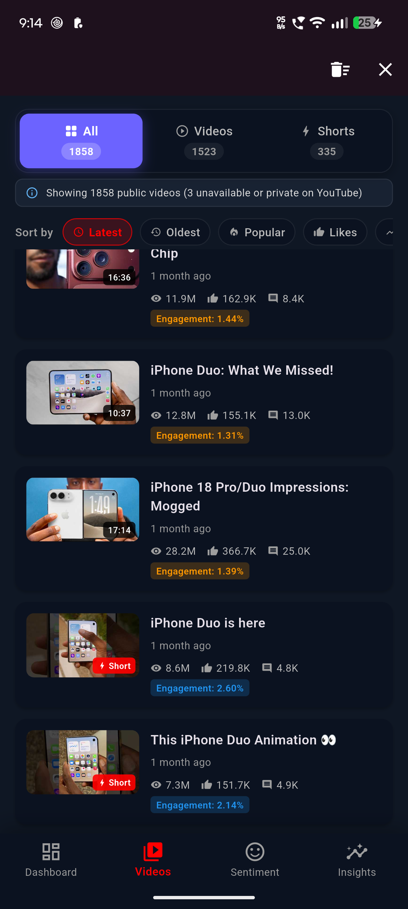
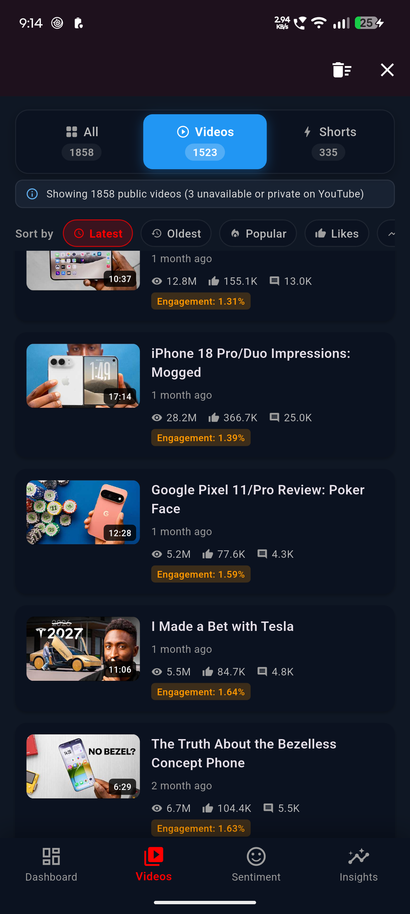
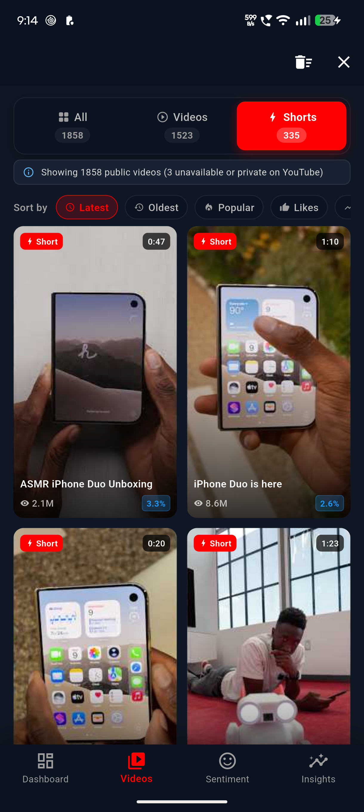
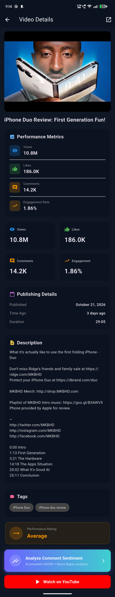
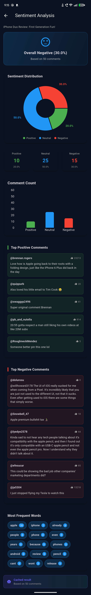
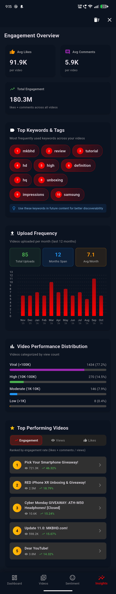

# 📊 Yutanz

  <strong>Modern YouTube Analytics & AI Comment Sentiment Intelligence for Creators and Marketers</strong>

  
  
  
  
  

---

## 📱 App Screenshots

<table align="center">
  <tr>
    <td align="center" width="25%">
      
       <strong>1. Channel Search</strong>
    </td>
    <td align="center" width="25%">
      
       <strong>2. Channel Dashboard</strong>
    </td>
    <td align="center" width="25%">
      
       <strong>3. Videos Catalogue</strong>
    </td>
    <td align="center" width="25%">
      
       <strong>4. Long-form Videos</strong>
    </td>
  </tr>
  <tr>
    <td align="center" width="25%">
      
       <strong>5. Shorts Grid</strong>
    </td>
    <td align="center" width="25%">
      
       <strong>6. Video Performance</strong>
    </td>
    <td align="center" width="25%">
      
       <strong>7. Sentiment Analysis</strong>
    </td>
    <td align="center" width="25%">
      
       <strong>8. Channel Insights</strong>
    </td>
  </tr>
</table>

---

## ✨ Key Features

### 1. 📈 Channel Overview & Dashboard
- **Channel Header:** View high-res avatar, verified badge, subscriber count, and bio.
- **Key Metrics Grid:** Total views (e.g. 5.8B), public videos count, average engagement rate, and average likes per video.
- **Quick Insights:** Exact channel launch date, average views per video, and total lifetime engagement.
- **Recent Uploads:** Quick previews of recent videos with duration badges, view counts, and engagement tags.

### 2. 🎬 Smart Videos & Shorts Categorization
- **YouTube-Style Category Tabs:**
  - **All Uploads:** Full pagination across the entire library with no arbitrary video caps.
  - **Videos:** Dedicated filter for standard long-form videos.
  - **Shorts:** Dedicated 2-column portrait (9:16) grid for YouTube Shorts (≤180s) with duration overlays.
- **Multi-Criteria Sorting:** Sort by **Latest**, **Oldest** (with First Upload spotlight), **Popular**, **Likes**, and **Engagement Rate**.
- **Transparency Notice:** Shows public video count alongside any private/unlisted videos.

### 3. 🎯 Robust Engagement & Performance Metrics
- **Mathematical Accuracy:** Engagement Rate = `((Likes + Comments) / Views) * 100`.
- **Hidden Likes Protection:** Videos where creators disabled like counts are detected automatically:
  - Displays `Hidden / N/A` badges instead of misleading `0%` or false "Below Average" ratings.
  - Excluded from channel average calculations so they do not artificially depress channel metrics.
  - Cleanly placed at the end when sorting by likes or engagement.
- **Performance Rating Tiers:** Benchmark grading (**Exceptional >10%**, **Excellent >5%**, **Good >2%**, **Average >1%**, **Below Average <1%**) with tailored recommendations.

### 4. 🧠 Fine-Tuned RoBERTa Comment Sentiment Analysis
- **Advanced Transformer Model:** Powered by [`roshan050/yt-sentiment-roberta`](https://huggingface.co/roshan050/yt-sentiment-roberta), fine-tuned from `cardiffnlp/twitter-roberta-base-sentiment-latest` specifically on real YouTube comments (`AmaanP314/youtube-comment-sentiment`).
- **Endpoint:** A Gradio 6 app (`backend/app.py`) that you run locally or host on your own Hugging Face Space. Setup, training and costs are documented in [backend/README.md](backend/README.md). The app sends comments in chunks of up to 200 per request and retries automatically.
- **Sentiment Distribution:** Donut chart showing exact percentage breakdowns for Positive, Neutral, and Negative sentiments with zero visual overlap.
- **Key Community Highlights:**
  - **Top Positive Comments:** Ranked by model positive confidence score.
  - **Top Negative Comments:** Ranked by model negative confidence score.
  - **Frequent Words Cloud:** Word frequency chips highlighting active discussion topics.

#### 🔬 Model Training Approach & Architecture
- **Base Model:** [`cardiffnlp/twitter-roberta-base-sentiment-latest`](https://huggingface.co/cardiffnlp/twitter-roberta-base-sentiment-latest) (RoBERTa transformer pretrained on diverse social media interactions).
- **Target Classes:** `negative`, `neutral`, `positive`.
- **Training Dataset:** [`AmaanP314/youtube-comment-sentiment`](https://huggingface.co/datasets/AmaanP314/youtube-comment-sentiment) (CC BY-SA 4.0 license).
- **Data Cleaning & Preprocessing:**
  - Removed all synthetic `_aug` rows.
  - Filtered to retain English and Latin-script comments only.
  - Deduplicated comments to prevent overfitting.
- **Data Partitioning:**
  - **Training set:** 49,114 comments
  - **Validation set:** 2,585 comments
  - **Held-out test set:** 5,186 comments (strictly partitioned by video — test comments originate from videos never seen during training).
- **Training Configuration:**
  - **Epochs:** 2
  - **Learning rate:** `2e-5`
  - **Batch size:** 32
  - **Weight decay:** 0.01
  - **Warmup steps:** 300
  - **Max sequence length:** 96 tokens
  - **Precision:** Mixed precision (FP16), completed in ~8.5 minutes on a Google Colab GPU.
- **Model Artifact:** Published to the Hugging Face Model Hub as [`roshan050/yt-sentiment-roberta`](https://huggingface.co/roshan050/yt-sentiment-roberta).
- **Reproduce it:** The training notebook is `backend/train_colab.ipynb`; see [backend/README.md](backend/README.md).

#### 📊 Benchmark Metrics (Held-Out Test Set: 5,186 Comments)
The test set consists of 5,186 comments from videos completely unseen during training.

| Model | Accuracy | Macro-Precision | Macro-Recall | Macro-F1 |
|---|---|---|---|---|
| **VADER (lexicon baseline)** | 0.5605 | 0.5503 | 0.5346 | 0.5329 |
| **Original cardiffnlp model** | 0.6996 | 0.6923 | 0.6939 | 0.6902 |
| **My fine-tuned model** | **0.7601** | **0.7523** | **0.7531** | **0.7511** |

##### Fine-Tuned Model Per-Class Performance
| Class | Precision | Recall | F1 | Support |
|---|---|---|---|---|
| **Negative** | 0.7122 | 0.8114 | 0.7586 | 1580 |
| **Neutral** | 0.7018 | 0.6420 | 0.6706 | 1503 |
| **Positive** | 0.8429 | 0.8060 | 0.8240 | 2103 |

##### Confusion Matrix
*(Rows = true negative / neutral / positive; Columns = predicted in the same order)*

~~~text
[[1282,  209,   89],
 [ 311,  965,  227],
 [ 207,  201, 1695]]
~~~

> ⚠️ **Honest Limitations:**
> - **Label Source:** The training and test labels come from an AI model with some manual validation, not from a fully human-labelled set, so the scores measure agreement with those labels.
> - **Language:** English only. Comments in other languages yield unreliable predictions.
> - **Class Difficulty:** Neutral is the hardest class.
> - **Dataset:** Evaluated on a single public YouTube comment dataset.

### 5. 📊 Deep Channel Insights & Trends
- **12-Month Upload Frequency:** Monthly bar chart displaying upload volume over the past 12 months with monthly average and total count.
- **Top Keywords & Tags:** Tag frequency analysis identifying the most utilized content keywords for SEO optimization.
- **Performance Distribution:** View count categorization into **Viral (>100K)**, **High (10K–100K)**, **Moderate (1K–10K)**, and **Low (<1K)**.
- **Top Performing Videos:** Switch ranking criteria between **Engagement Rate**, **Total Views**, and **Total Likes**.

### 6. ⚡ Smart Local Caching (Hive NoSQL)
- Instant sub-second loading for revisited channels, video lists, and sentiment reports.
- Full offline persistence: preserves sentiment breakdowns, word frequencies, and top positive/negative comments.
- Quota-friendly: prevents redundant YouTube API quota consumption.

---

## 🛠️ Tech Stack

| Layer | Technology |
|---|---|
| **Frontend** | Flutter 3.x, Dart 3.x |
| **State Management** | `Provider` architecture |
| **Local Database** | `hive` & `hive_flutter` (Lightweight NoSQL key-value store) |
| **Charts & Graphics** | `fl_chart`, `flutter_animate`, `shimmer` |
| **Backend & ML** | Fine-tuned RoBERTa (`roshan050/yt-sentiment-roberta`), Gradio 6, Hugging Face Hub / Spaces |
| **Data Source** | YouTube Data API v3 |

---

## 🚀 Getting Started

### Prerequisites
- [Flutter SDK](https://docs.flutter.dev/get-started/install) (v3.0 or higher)
- A free [YouTube Data API v3 key](https://console.cloud.google.com/). Each person uses their own key; never commit it.
- A running sentiment backend (see step 2; its own requirements are listed in [backend/README.md](backend/README.md))

### 1. Clone the repository

~~~bash
git clone https://github.com/your-username/yutanz.git
cd yutanz
~~~

### 2. Set up the sentiment backend
Follow [backend/README.md](backend/README.md). You can run it on your own computer or host it on your own Hugging Face Space. When it is running, you will have a URL for it, such as `http://localhost:7860` or your Space URL. You need that URL in the next step.

### 3. Configure environment variables
Copy the template and fill it in:

~~~bash
cp .env.example .env
~~~

~~~env
# Your YouTube Data API v3 key
YOUTUBE_API_KEY=your_youtube_api_key_here

# URL of your sentiment backend (local or your own Hugging Face Space)
SENTIMENT_API_URL=http://localhost:7860
~~~

### 4. Install dependencies & run

~~~bash
flutter pub get
flutter run
~~~

---

## 🩺 Troubleshooting

| Problem | What to try |
|---|---|
| Sentiment results do not load | Check that your backend is running and that `SENTIMENT_API_URL` in `.env` is correct. See the troubleshooting section in [backend/README.md](backend/README.md). The app falls back to its on-device sentiment engine when the backend is unreachable. |
| "Quota exceeded" error from YouTube | The free YouTube Data API quota (10,000 units per day) resets daily. Revisited channels load from the local cache and do not use quota. |
| Environment variables are not picked up | Make sure `.env` exists in the project root (copied from `.env.example`), then restart the app completely instead of hot reloading. |

---

## 📁 Project Structure

~~~text
Yt_Analyzer/
├── assets/                        # App icons and visual assets
├── backend/                       # Sentiment backend and training (see backend/README.md)
│   ├── README.md                  # Backend setup, Space hosting, training, costs
│   ├── app.py                     # Gradio server (runs locally or on a Hugging Face Space)
│   ├── requirements.txt           # Python dependencies for running locally
│   ├── train_colab.ipynb          # Colab notebook used to fine-tune the model
│   └── METRICS.md                 # Evaluation results of the trained model
├── lib/                           # Flutter Core
│   ├── models/                    # Data models
│   │   ├── analytics_model.dart   # ChannelAnalytics & SentimentAnalysis
│   │   ├── channel_model.dart     # Channel details
│   │   ├── comment_model.dart     # Comment structure & reply parser
│   │   └── video_model.dart       # Video metadata & engagement logic
│   ├── providers/                 # State management (Provider)
│   │   ├── channel_provider.dart  # Channel & videos state
│   │   └── video_provider.dart    # Video comments & sentiment state
│   ├── screens/                   # User Interfaces
│   │   ├── dashboard_screen.dart  # Home & channel dashboard
│   │   ├── videos_screen.dart     # Videos & Shorts categorized tabs
│   │   ├── video_details_screen.dart # Performance & metrics
│   │   ├── sentiment_screen.dart  # Sentiment breakdown & charts
│   │   ├── insights_screen.dart   # Frequency & top video insights
│   │   └── settings_screen.dart   # Settings & API preferences
│   ├── services/                  # Network & Cache services
│   │   ├── youtube_api_service.dart # YouTube Data API v3 client
│   │   ├── search_service.dart    # Channel & video search suggestions
│   │   ├── sentiment_api_service.dart # Gradio API client
│   │   ├── sentiment_service.dart # On-device sentiment fallback
│   │   └── cache_service.dart     # Hive local database manager
│   ├── utils/                     # Formatting, helpers, transitions
│   └── widgets/                   # Reusable UI components
├── screenshots/                   # App demonstration screenshots
├── .env.example                   # Environment template
└── pubspec.yaml                   # Flutter dependencies
~~~

---

## 🔒 Security & Best Practices

- **`.env` Ignored in Version Control:** Credentials are kept strictly local through `.gitignore`. Never commit your YouTube API key or a Hugging Face token.
- **API Quota Optimization:** Hive caching prevents unnecessary repetitive requests to YouTube API.
- **Fail-Safe Fallbacks:** The app includes a built-in on-device rule-based sentiment engine if the remote backend is unreachable or out of quota.

---

## 🙏 Credits & Licenses

- Base model: [cardiffnlp/twitter-roberta-base-sentiment-latest](https://huggingface.co/cardiffnlp/twitter-roberta-base-sentiment-latest)
- Training data: [AmaanP314/youtube-comment-sentiment](https://huggingface.co/datasets/AmaanP314/youtube-comment-sentiment) (CC BY-SA 4.0)
- Fine-tuned model: [roshan050/yt-sentiment-roberta](https://huggingface.co/roshan050/yt-sentiment-roberta)

---

## 📄 License

This project's code is licensed under the [MIT License](LICENSE). The model and dataset have their own licenses (see above).